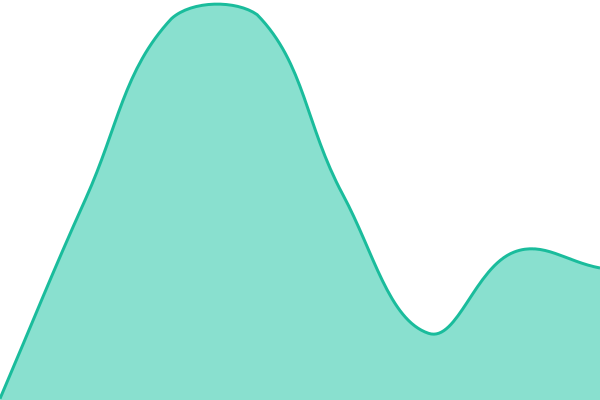
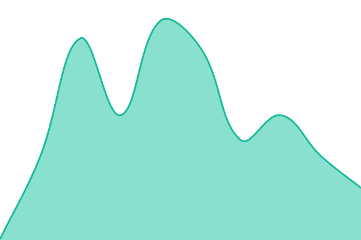

# Estado de Trivia Croydonistas 2026

This repository contains the open-source uptime monitor and status page for [Antisacsor S.A.S](www.antisacsor.com), powered by [Upptime](https://github.com/upptime/upptime).

<!--start: status pages-->
<!-- This summary is generated by Upptime (https://github.com/upptime/upptime) -->
<!-- Do not edit this manually, your changes will be overwritten -->
<!-- prettier-ignore -->
| URL | Status | History | Response Time | Uptime |
| --- | ------ | ------- | ------------- | ------ |
|  [API](https://api.massivespace.pro/health) | En línea | [api.yml](https://github.com/Antisacsor/croydonista-status/commits/HEAD/history/api.yml) | 

 151ms
     
 | 

<a href="https://status-croydonista.massivespace.pro/history/api">100.00%</a>
    

|  [Base de datos (Postgres)](https://api.massivespace.pro/health) | En línea | [base-de-datos.yml](https://github.com/Antisacsor/croydonista-status/commits/HEAD/history/base-de-datos.yml) | 

 114ms
     
 | 

<a href="https://status-croydonista.massivespace.pro/history/base-de-datos">100.00%</a>
    

|  [Caché y sesiones (Redis)](https://api.massivespace.pro/health) | En línea | [redis.yml](https://github.com/Antisacsor/croydonista-status/commits/HEAD/history/redis.yml) | 

 89ms
     
 | 

<a href="https://status-croydonista.massivespace.pro/history/redis">100.00%</a>
    

|  [App de la participante](https://trivia.massivespace.pro) | En línea | [trivia.yml](https://github.com/Antisacsor/croydonista-status/commits/HEAD/history/trivia.yml) | 

 96ms
     
 | 

<a href="https://status-croydonista.massivespace.pro/history/trivia">100.00%</a>
    

|  [Panel de administración](https://admin.massivespace.pro) | Caído | [admin.yml](https://github.com/Antisacsor/croydonista-status/commits/HEAD/history/admin.yml) | 

 178ms
     
 | 

<a href="https://status-croydonista.massivespace.pro/history/admin">99.97%</a>
    

<!--end: status pages-->

[**Visit our status website →**](https://Antisacsor.github.io/croydonista-status)
